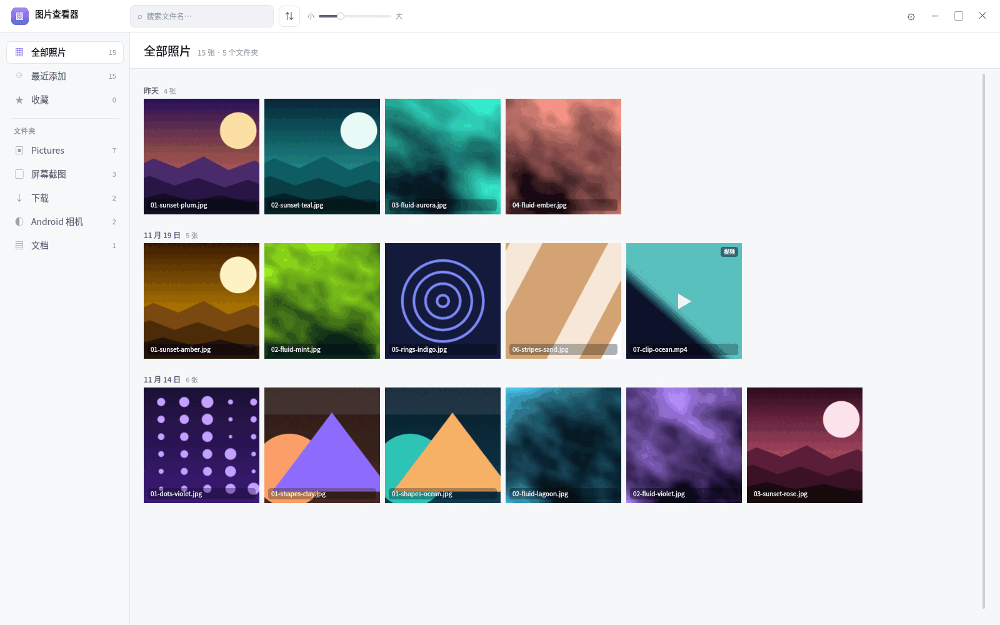
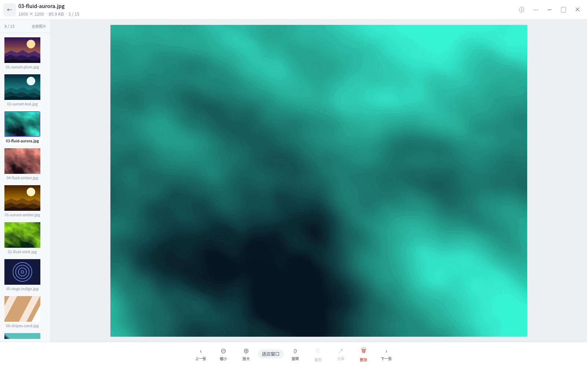
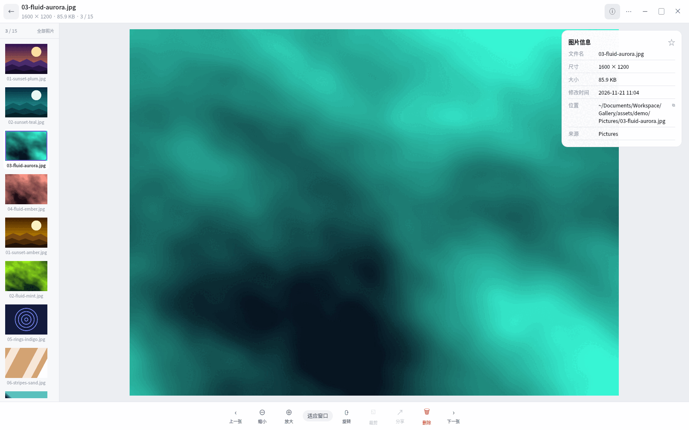
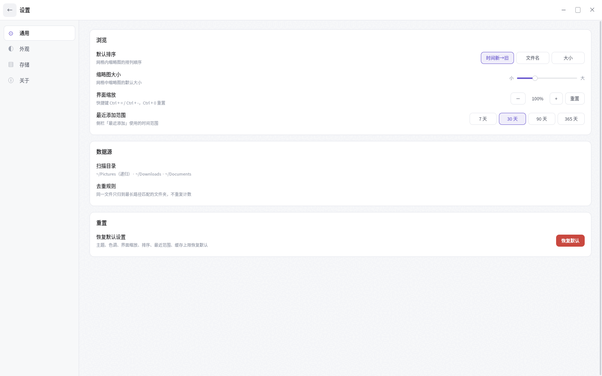
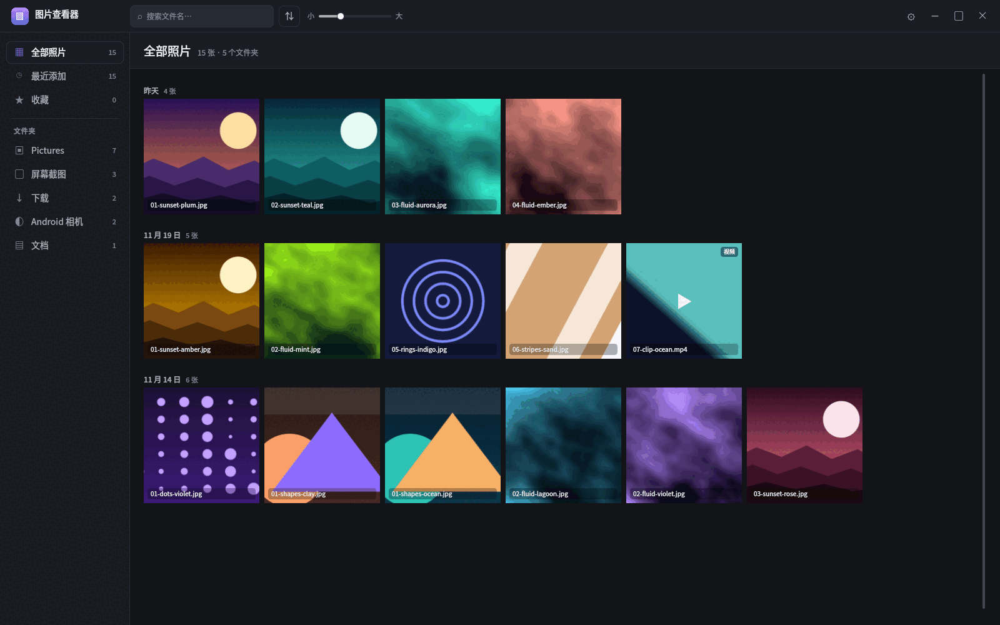
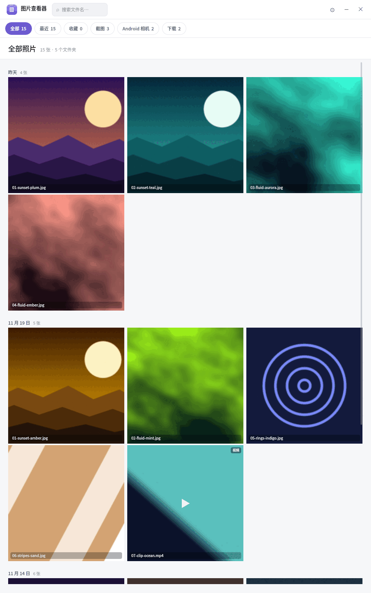

# Gallery

**Denial 平板上的原生图片查看器** —— Qt 6 / QML 编写的本地相册，为小米平板 5 的 Wayland 合成器打造，也能在任意 Linux 桌面上运行。


<p align="center">
  
</p>

## 功能

- **浏览**：侧栏分类与文件夹、按日期自动分组、实时搜索、时间 / 文件名 / 大小三种排序、缩略图大小滑块、键盘方向键与 Enter 导航、长按多选批量删除、拖放打开文件、视频首帧缩略图。
- **查看**：filmstrip 快速切换、双击在「适应窗口」与 100% 间切换、捏合或 Ctrl + 滚轮缩放（10%–800%）、缩放后拖动平移、旋转、信息面板、收藏、复制路径、GIF / WebP 动图播放。
- **性能**：扫描边进行边分批显示，首屏约 150ms 可见；索引缓存让二次启动秒开（27 万张实测约 0.35s）；目录变化增量重扫，单个目录约 5–6ms；可见行按需构建，峰值内存约 338MB。
- **数据与集成**：删除一律移入 XDG 回收站（绝不直接 unlink）；单实例转发、窗口几何记忆、`.desktop` 与应用图标集成。
- **外观与设置**：亮色 / 暗色 / 跟随系统主题、全局色调、界面整体缩放（Ctrl + = / - / 0）、缩略图缓存上限与清理、手动重建索引。

## 截图

<table>
  <tr>
    <td width="50%"></td>
    <td width="50%"></td>
  </tr>
  <tr>
    <td align="center">查看模式：filmstrip + 舞台 + 底部操作栏</td>
    <td align="center">信息面板：尺寸、大小、修改时间、路径</td>
  </tr>
  <tr>
    <td width="50%"></td>
    <td width="50%"></td>
  </tr>
  <tr>
    <td align="center">设置：排序、缩略图、界面缩放</td>
    <td align="center">暗色主题</td>
  </tr>
  <tr>
    <td colspan="2" align="center">
      <br>
      竖屏：侧栏收为顶部 chips，网格 3 列
    </td>
  </tr>
</table>

## 构建

依赖 Qt 6.5+（Core / Gui / Qml / Quick / QuickControls2 / Concurrent）、CMake 3.21+、Ninja；视频缩略图需要 `ffmpeg`。

Arch Linux 上：

```bash
sudo pacman -S --needed base-devel cmake ninja \
    qt6-base qt6-declarative qt6-wayland qt6-svg qt6-imageformats ffmpeg
```

编译并运行：

```bash
cmake --preset linux-release
cmake --build --preset linux-release -j8
./build/linux-release/bin/gallery
```

装了 [just](https://github.com/casey/just) 的话，`just b`（Debug 构建）、`just r`（构建并运行）、`just shot`（离屏截图）更省事。

### 用 mcpp 构建（可选）

也可以用 [mcpp](https://github.com/mcpp-community/mcpp) 构建（QML 走官方 `rules-qml` 插件，与 CMake 共用同一份源码）：

```bash
mcpp build --profile debug/release
mcpp run
```

### 用演示数据运行

默认会扫描 `~/Pictures`、`~/Downloads`、`~/Documents`。想用干净的演示图库（本仓库 README 截图就是用它生成的）：

```bash
./scripts/gen-demo-data.sh                       # 生成 assets/demo/
GALLERY_HOME=assets/demo ./build/linux-release/bin/gallery
```

### 部署到平板

```bash
./scripts/deploy-arm.sh          # 同步源码到设备并原地编译（arm64）
./scripts/package-pacman.sh      # 生成 Arch pacman 包（产物在 dist/pacman/）
./scripts/package-pacman.sh -i   # 构建并安装
```

## 文档

- [docs/GALLERY.md](docs/GALLERY.md) — 设计规范（权威需求）
- [docs/CONTEXT.md](docs/CONTEXT.md) — 目标设备、环境实测事实与首期范围
- [docs/DEVELOPMENT.md](docs/DEVELOPMENT.md) — 目录结构、开发用环境变量、交互速查
- [design/gallery-redesign.html](design/gallery-redesign.html) — 视觉设计稿（浏览器打开）

## 路线图

裁剪与写回、分享、幻灯片、视频播放、EXIF 深度解析、单元测试。

## 许可证

[MIT](LICENSE) © 2026 子菲鱼
